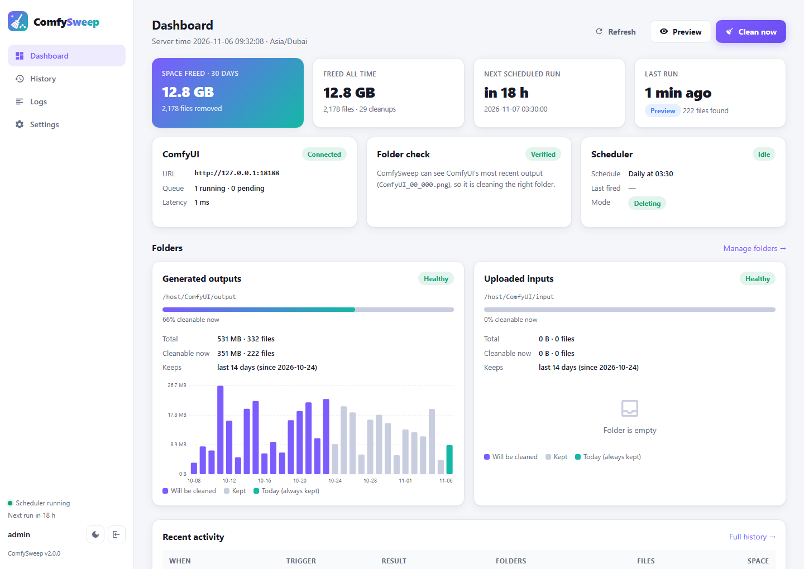
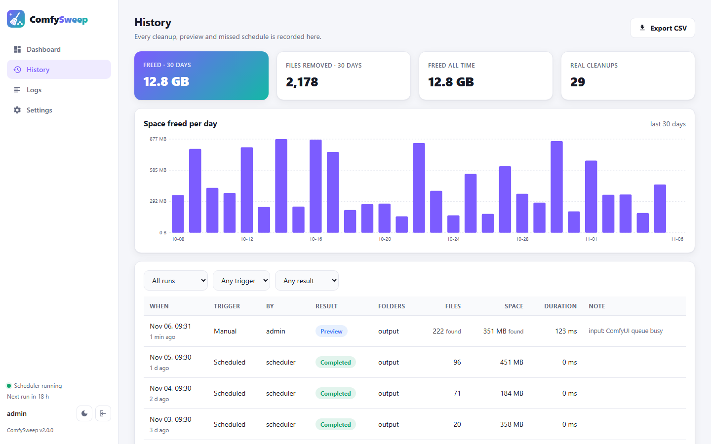
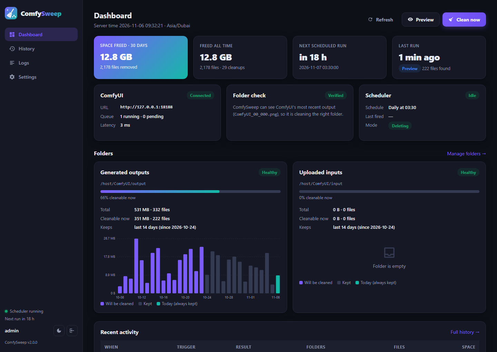
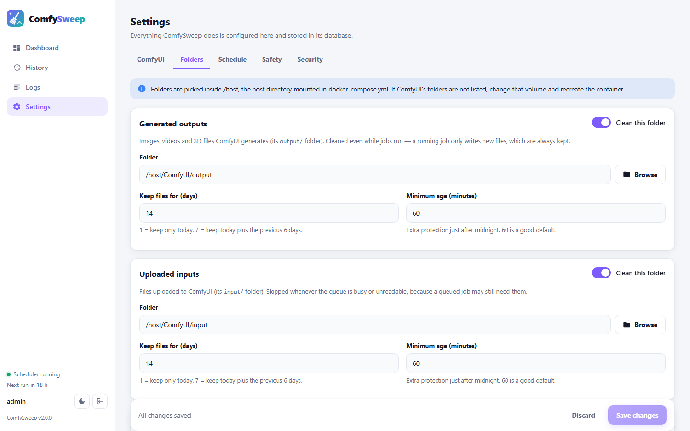
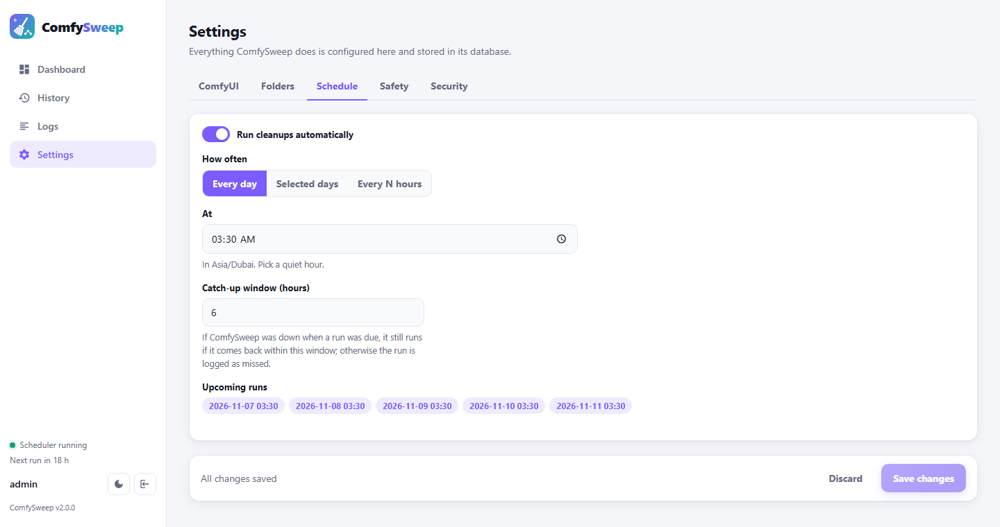
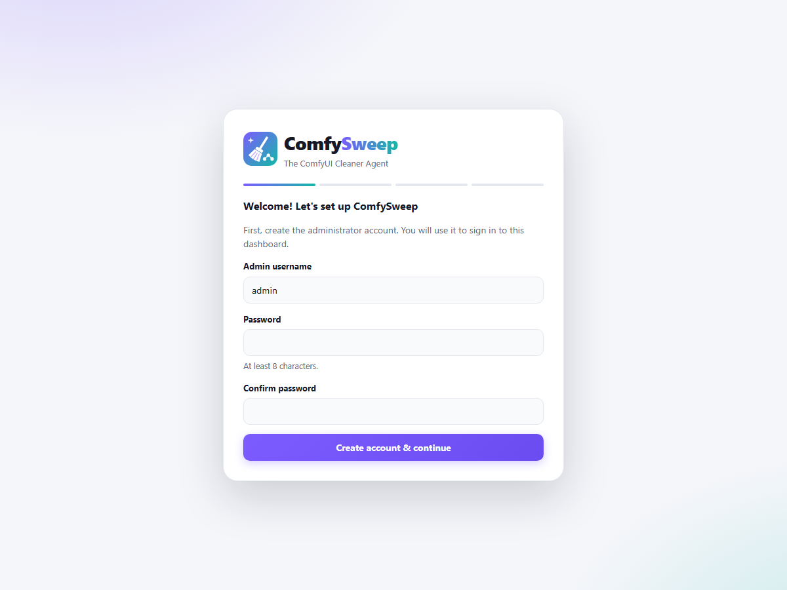
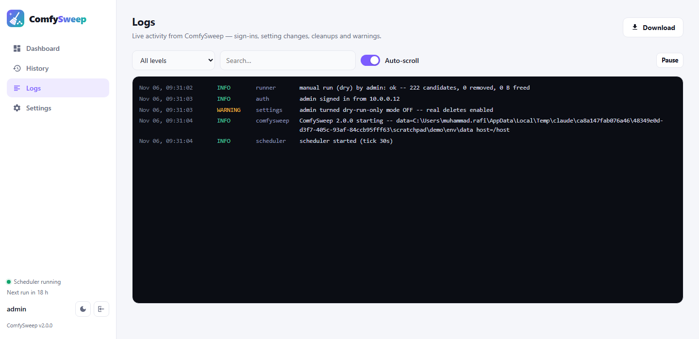

<p align="center">
  
</p>

<h1 align="center">ComfySweep</h1>

<p align="center">
  <b>The ComfyUI Cleaner Agent.</b> Keep your GPU box lean, automatically.<br>
  Scheduled, safety-first cleanup of ComfyUI's generated and uploaded files, with a web dashboard.
</p>

<p align="center">
  <a href="https://github.com/mkamranr/comfysweep/actions/workflows/tests.yml"></a>
  
  
  
  
  
</p>

<p align="center">
  
</p>

---

ComfyUI never deletes anything. Every image, video and 3D file it generates, and every
image uploaded to it, stays in `output/` and `input/` forever, until the disk fills up
and renders start failing. **ComfySweep** runs next to ComfyUI on the same server and
cleans those folders on a schedule you choose, so you don't have to.

## Features

- **Web dashboard**: disk usage per folder and per day, what can be cleaned right now,
  ComfyUI's status, next and last run, and space freed over time.
- **Scheduler**: daily, on selected weekdays, or every N hours, in your timezone.
- **Preview before you delete**: every manual cleanup shows exactly how many files and
  how many GB it would remove before anything is touched.
- **Full history**: when each cleanup ran, who or what triggered it, how many files it
  removed and how much space it freed. Filterable and exportable to CSV.
- **Live logs**: sign-ins, setting changes, cleanups and warnings, streamed in the browser.
- **Everything configured in the UI**: ComfyUI URL, folders (with a folder browser),
  retention per folder, schedule, safety limits. There is no `.env` file to edit.
- **Safety first** (see [the safety model](docs/safety.md)):
  - files from **today are never deleted**, whatever the settings say
  - **dry-run-only mode** is on by default, so the first run only counts files
  - before a real cleanup, ComfySweep **asks ComfyUI** whether the folder you chose is
    really its output folder, and refuses to delete if it is not
  - uploaded inputs are **skipped while ComfyUI's queue is busy**, so a queued job never
    loses its input image
  - every file is re-checked just before it is deleted, symlinks are never followed, and
    nothing outside the chosen folders can be touched
- **Secure by default**: admin login (scrypt-hashed passwords), CSRF protection, login
  throttling, API keys for scripts, and a minimal-privilege container.
- **Works offline**: no CDNs or external fonts, and no calls home. Build the image once,
  then `docker save`/`docker load` it onto an air-gapped server.
- **Light and dark themes.**

## Quick start

Requirements: Docker with Compose, on **the same server as ComfyUI**. ComfySweep deletes
files directly, so it must be able to see ComfyUI's folders.

```bash
git clone <this repository> comfysweep && cd comfysweep
```

**1. Point ComfySweep at your ComfyUI folders.** Open `docker-compose.yml` and change
the left-hand side of this one line to the host folder that **contains** ComfyUI's
`output/`, `input/` and `temp/` folders:

```yaml
    volumes:
      - /opt/ComfyUI:/host        # ← your ComfyUI folder on this server
```

> Running ComfyUI itself in Docker? Find its real host folders with
> `docker inspect <comfyui-container> --format '{{range .Mounts}}{{.Source}} -> {{.Destination}}{{"\n"}}{{end}}'`.
> See [Installation](docs/installation.md#1-find-comfyuis-folders) for details.

**2. Start it.**

```bash
docker compose up -d --build
```

**3. Open `http://<your-server>:8191`.** The setup wizard walks you through creating the
admin account, connecting to ComfyUI, picking folders and setting a schedule.

**4. Rehearse, then go live.** Click **Preview** on the dashboard. When the numbers look
right, turn off *Dry-run-only mode* in **Settings → Safety**. From then on the schedule
cleans for real.

## How ComfySweep decides what to delete

For each enabled folder you set **Keep files for N days**. A file is deleted only when
**all three** of these are true:

| Rule | Example with "keep 7 days" on Nov 10 |
|---|---|
| 1. It was **not** last modified **today** (in your timezone). This rule ignores the keep setting, so it can never be misconfigured. | anything from Nov 10 is kept |
| 2. It is **older than the keep window**. | anything from Nov 4 to Nov 10 is kept |
| 3. It is **older than the minimum age** (default 60 min), which protects files written just before midnight. | |

Folders are scanned recursively (ComfyUI writes `video/`, `3d/` and custom sub-folders).
Sub-folders left empty afterwards are removed; the chosen folder itself is never removed.

| Folder | Default retention | Cleaned while ComfyUI is busy? |
|---|---|---|
| **Generated outputs** (`output/`) | keep 7 days | Yes. A running job only writes *new* files, which are always kept. |
| **Uploaded inputs** (`input/`) | keep 14 days | **No.** A queued job may still need its input, so this folder is skipped while the queue is busy or can't be read. |
| **Temporary previews** (`temp/`) | keep 1 day | **No**, skipped while the queue is busy. |

## Screenshots

| | |
|---|---|
|  |  |
| **History**: every run, with space freed per day | **Dark mode** |
|  |  |
| **Settings → Folders**, with a built-in folder browser | **Settings → Schedule**, previewing upcoming runs |
|  |  |
| **First-run setup wizard** | **Live logs** |

## Documentation

| | |
|---|---|
| [Installation](docs/installation.md) | Docker setup, finding ComfyUI's folders, air-gapped servers, reverse proxies, upgrading |
| [Configuration](docs/configuration.md) | Every setting in the UI, explained |
| [Safety model](docs/safety.md) | Exactly how ComfySweep avoids deleting the wrong thing |
| [API](docs/api.md) | REST API and API keys, for scripts and monitoring |
| [Troubleshooting](docs/troubleshooting.md) | "Not writable", "wrong folder", lost password, and more |

## FAQ

**Does ComfySweep call ComfyUI's "clear history" or "free memory" endpoints?**
No. It only ever makes three read-only requests: `GET /queue`, `GET /history` and
`GET /view`. It never touches ComfyUI's history, queue or loaded models.

**Can it run on a different server from ComfyUI?**
No. It deletes files directly from disk, so it must run where ComfyUI's folders are.
You can still open its dashboard from anywhere on your network.

**What happens if the server was off when a cleanup was due?**
If it comes back within the *catch-up window* (default 6 hours), the run happens then.
Otherwise the run is recorded as *Missed* in History and the next scheduled run goes ahead
as normal, so a cleanup never starts unexpectedly in the middle of a working day.

**Where is my data?**
In `./data/comfysweep.db` (SQLite) next to `docker-compose.yml`: settings, users,
history and logs. Back up that one file and you have backed up ComfySweep.

**I forgot the admin password.**
`docker exec -it comfysweep python -m app.cli reset-password admin`

## Development

```bash
pip install -r requirements-dev.txt
pytest -q                        # the test suite, no Docker or ComfyUI needed

# run locally against a scratch folder
mkdir -p /tmp/cs/host/ComfyUI/output
COMFYSWEEP_DATA_DIR=/tmp/cs/data COMFYSWEEP_HOST_ROOT=/tmp/cs/host \
  uvicorn app.main:app --port 8191 --reload
```

Project layout:

```
app/
  core/cleaner.py   the age rules, scanning and deletion
  core/comfy.py     read-only ComfyUI checks (queue, folder verification)
  runner.py         one cleanup run, from preview to history record
  scheduler.py      the built-in scheduler
  settings.py       every setting, its defaults and validation
  auth.py           users, sessions, API keys
  api/              REST endpoints
  cli.py            selftest / reset-password
web/                the dashboard (plain HTML/CSS/JS, no build step)
tests/              pytest suite
docs/               documentation
```

## License

[MIT](LICENSE)
